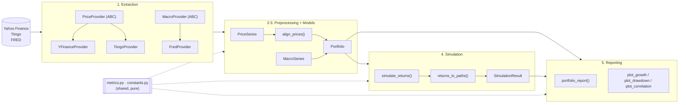
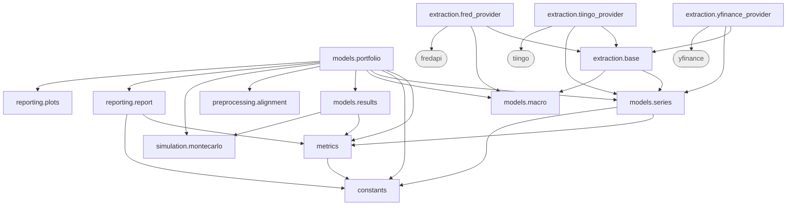
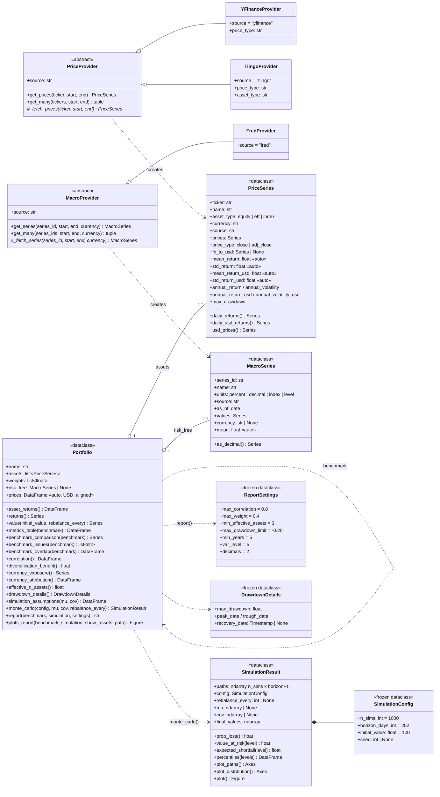
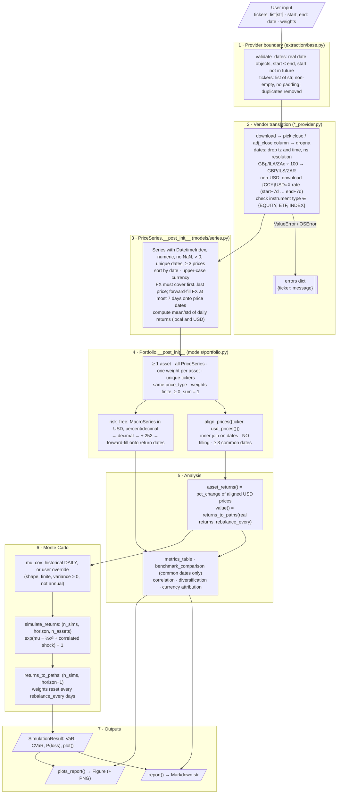
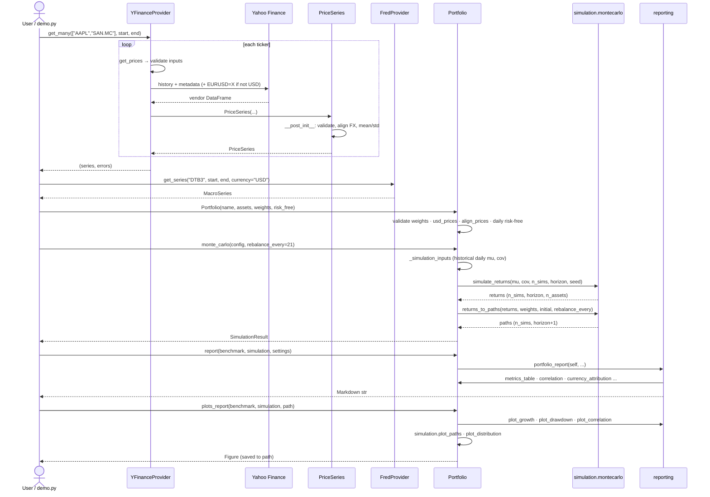

# Architecture

This document covers task 4.6 of the assignment: the class hierarchy, the
dependencies and the flow of the system. All diagrams are Mermaid, so GitHub
renders them directly. Each one describes the code as it is in `src/miax_toolkit/`.

1. [Layers](#1-layers)
2. [Module dependencies](#2-module-dependencies)
3. [Class diagram (UML)](#3-class-diagram-uml)
4. [Data flow](#4-data-flow)
5. [Sequence: from tickers to report](#5-sequence-from-tickers-to-report)
6. [Data contracts](#6-data-contracts)
7. [Extension points](#7-extension-points)

---

## 1. Layers

The toolkit has five layers. Data only moves forward. Each layer hands the next
a validated, standardised object, never a raw vendor format.

| # | Layer | Package | Responsibility | Output |
|---|---|---|---|---|
| 1 | Extraction | `extraction/` | Talk to the APIs, validate request inputs, translate vendor formats | `PriceSeries`, `MacroSeries` |
| 2 | Preprocessing | `preprocessing/`, `PriceSeries.__post_init__` | Clean (NaN, ≤ 0, duplicates), sort, normalise dates, convert to USD, align calendars | Clean USD prices on common dates |
| 3 | Models | `models/` | Domain objects: series, portfolio, simulation results | `Portfolio` |
| 4 | Simulation | `simulation/` | Correlated GBM returns and path building with rebalancing | `SimulationResult` |
| 5 | Reporting | `reporting/` | Format numbers as Markdown and draw charts | `str` (Markdown), `matplotlib.Figure` |

`metrics.py` and `constants.py` are shared kernels. They hold pure functions and
constants that every layer uses, and they depend on nothing inside the package.

---

## 2. Module dependencies

Runtime imports inside `miax_toolkit`. External libraries are in grey. The graph
has no cycles.

Properties of this graph that matter for the design:

- **Ingestion is isolated.** Only `extraction/*` imports `yfinance`, `tiingo`
  or `fredapi`. Nothing outside `extraction/` knows which API produced a
  series.
- **Models do not depend on extraction.** A `PriceSeries` can be built from
  any source, including a CSV file or a test fixture.
- **Engines are pure.** `metrics`, `preprocessing.alignment`,
  `simulation.montecarlo` and `reporting.plots` take pandas or numpy objects
  and return new ones. They know nothing about `Portfolio`, so each one can be
  tested on its own.
- **`Portfolio` is the façade.** It wires the engines together and exposes
  `monte_carlo()`, `report()` and `plots_report()` as methods, as the
  assignment requires.
- **Reporting does not import `Portfolio` at run time.** `reporting.report`
  imports it only under `TYPE_CHECKING`, for type hints. This avoids an import
  cycle and keeps the formatting code independent of the model.

---

## 3. Class diagram (UML)

Notes:

- `get_prices` and `get_many` are concrete **template methods**. They validate
  the inputs and then call the abstract `_fetch_prices`, so every provider gets
  the same validation and batching for free.
- Fields marked «auto» use `field(init=False)` and are computed in
  `__post_init__`. In particular, the mean and standard deviation the
  assignment asks for (task 4.3) exist as soon as the object is created.
- A benchmark is just another `Portfolio`. A single index is a one-asset
  portfolio with weight `[1.0]`.

---

## 4. Data flow

What happens to the data at each step, and which rule is enforced there.

Two choices in this flow deserve emphasis. Both are explained in
[design_decisions.md](design_decisions.md).

- **Asset prices are never filled. FX rates are forward-filled for at most 7
  days.** Filling a missing price creates a fake 0 % return, which lowers
  volatility and correlation. An FX rate is a level that stays valid until the
  next quote, and the 7-day limit stops a stale rate from being used for long.
- **The same path engine (`returns_to_paths`) values both history and
  simulation.** The historical value and the Monte Carlo paths therefore apply
  the same rebalancing rule.

---

## 5. Sequence: from tickers to report

---

## 6. Data contracts

These invariants hold for every object, whichever provider created it. This is
what "standardised output" (task 4.2) means in practice.

| Object | Field | Contract |
|---|---|---|
| `PriceSeries` | `prices` | `pd.Series`, `DatetimeIndex` tz-naive at midnight in `ns` resolution, sorted ascending, unique dates, numeric, no NaN, all > 0, at least 3 values |
| | `currency` | ISO code, upper case, main unit (never pence or cents) |
| | `fx_to_usd` | `None` if the currency is USD. Otherwise USD per unit of currency, on exactly the dates of `prices` |
| | `asset_type` | `equity`, `etf` or `index` |
| | `price_type` | `close` or `adj_close` |
| `MacroSeries` | `values` | `pd.Series`, `DatetimeIndex`, sorted, unique, numeric, no NaN, at least 1 value |
| | `units` | `percent` (3.75), `decimal` (0.0375, \|x\| ≤ 0.5), `index` or `level` |
| `Portfolio` | `prices` | `DataFrame` with one column per ticker, **in USD**, only the dates shared by all assets, at least 3 rows |
| | `weights` | `float`, finite, ≥ 0, one per asset, sum to 1 |
| `SimulationResult` | `paths` | `ndarray` of shape `(n_sims, horizon_days + 1)`. Column 0 is `initial_value` |
| | `mu`, `cov` | **Daily** simple-return mean and covariance, given together or not at all |

Units used throughout: returns are **daily simple returns** as decimals.
Annualisation uses 252 trading days (`constants.TRADING_DAYS`), except CAGR,
which uses 365.25 calendar days.

---

## 7. Extension points

| To add... | Do this | What else changes |
|---|---|---|
| A new price API (Alpha Vantage, Polygon...) | Subclass `PriceProvider`, set `source`, implement `_fetch_prices` returning a `PriceSeries` | Nothing. Validation and `get_many` are inherited |
| A new macro or fundamentals source | Subclass `MacroProvider` and implement `_fetch_series` | Nothing |
| A new metric | Add a pure function to `metrics.py`, then a column in `Portfolio._metrics_row` | The report picks it up only if added to the table formatting |
| A new chart | Add a function to `reporting/plots.py` that takes a DataFrame and an `ax` | Wire it into `Portfolio.plots_report` |
| A new warning rule | Add a check in `reporting.report.risk_warnings` and, if it needs a threshold, a field in `ReportSettings` | Nothing |
| A different simulation model | Add a function with the same output shape as `simulate_returns` | `Portfolio.monte_carlo` would need a parameter to choose the model |
